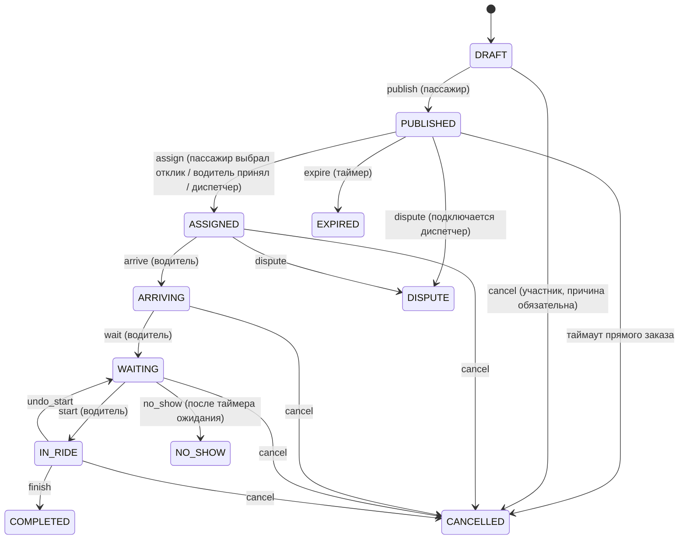

# TaxiChat

Текстовый мессенджер для заказа частного такси в городах России: заказ — это
чат-комната с ролями, а не приложение с картой. Концепция описана в
`taxichat-concept-and-prompt.md`.

## Запуск

Требуется Node.js 18+ (проверено на 24) и MongoDB.

```bash
# 1. База данных и TURN (опционально) через Docker
docker compose up -d mongo
# coturn (голосовые звонки): docker compose up -d coturn

# 2. Переменные окружения
copy .env.example .env   # заполните MONGO_URI, JWT_SECRET_KEY, Cloudinary, TURN

# 3. Справочники и демо-данные (3 региона, 5 городов, зоны, ориентиры, аккаунты)
npm run seed

# 4. Сервер + сокеты + фоновые задачи
npm run dev              # http://localhost:4000

# 5. Клиент (отдельный терминал)
cd client && npm install && npm start   # http://localhost:3000 (прокси на :4000)
```

Тесты: `npm test` (jest + supertest + mongodb-memory-server, 107 тестов).

Проверка полного dev-цикла (Mongo в памяти, API, CRA dev-сервер, прокси REST
и WebSocket): `npm run smoke:dev`.

### Демо-аккаунты (после `npm run seed`)

Все с паролем `password123`. Казань — PILOT (диспетчер + 3 водителя), Самара — WAITLIST.

| Логин | Роль |
|---|---|
| `passenger` | пассажир в Казани |
| `driver1`…`driver3` | водители в Казани |
| `dispatcher` | диспетчер Казани |
| `dispatcher2` | диспетчер Самары |
| `regionadmin` | админ Самарской области |
| `superadmin` | суперадмин платформы |

## Данные

- **Region, City, Zone, Landmark** — справочник без карт: зоны со смежностью
  (граф вместо радиуса), ориентиры с текстовым индексом и синонимами.
- **User** — логин, имя, аватар, `banned`, домашний город (смена раз в 30 дней).
- **Membership** — роль принадлежит городу: `passenger | driver | dispatcher |
  region_admin` × `WAITLIST | PENDING | ACTIVE | REJECTED | SUSPENDED`;
  уникальный индекс `{userId, cityId, role}`.
- **DriverProfile** — анкета: имя, телефон `+7XXXXXXXXXX` (один на аккаунт),
  машина («цвет + номер», уникально среди активных водителей города), смена
  (`online | busy | offline`), heartbeat, `acceptDirectCalls`, `inCall`,
  кэш рейтинга.
- **Order** — заказ со статусом и `statusLog`; точные адреса скрыты от
  водителя до ASSIGNED; режим `broadcast | direct`; `shareToken` для ссылки
  «поделиться поездкой» (только во время поездки).
- **Offer** — отклик водителя: цена текстом + ETA.
- **Chat** (`order | direct | zone | city`) и **Message**
  (`text | voice | photo | system | action | offer | order_card`) — в чате
  заказа работают текст, фото и голосовые (Cloudinary); сообщения завершённых
  заказов удаляются TTL через 90 дней.
- **CallLog** — только метаданные звонков (голос не записывается).
- **Rating, Complaint, Block, Favorite, Application, AuditLog**.

## Статусы заказа



Любое изменение статуса проходит через единый `transition(order, event,
actor)` (services/orderService.js): проверка таблицы переходов и роли, запись
в `statusLog`, системное сообщение бота в чат, обновление закреплённой
карточки, кнопки-действия, смена смены водителя, событие в сокетах.
Назначение — атомарное `findOneAndUpdate` по `_id + status: PUBLISHED`
(гонка «первый принял» даёт ровно одного победителя).

## REST API (основное)

| Метод | Путь | Описание |
|---|---|---|
| POST | `/api/user/register`, `/api/user/login`, `/logout` | сессия (JWT в httpOnly-куке) |
| GET | `/api/user/me` | пользователь + членства + анкеты |
| GET | `/api/geo/regions`, `/cities`, `/cities/:id/zones`, `/cities/:id/landmarks` | география |
| POST/GET/PATCH | `/api/memberships` | стать пассажиром/водителем, мои членства, зоны |
| GET/PATCH | `/api/dispatch/:cityId/drivers`, `/api/dispatch/drivers/:id` | очередь анкет, одобрение |
| POST/GET | `/api/applications` | заявка на диспетчера/админа |
| GET/PATCH | `/api/admin/applications`, `/roles`, `/audit`, `/users/:id/ban` | роли, журнал, блокировки |
| POST/GET | `/api/orders` | создать заказ, список (сериализация по роли) |
| GET | `/api/orders/:id` | карточка (сокрытие адресов до ASSIGNED) |
| POST | `/api/orders/:id/action`, `/cancel`, `/dispute`, `/decline`, `/republish` | жизненный цикл |
| GET/POST | `/api/orders/:id/offers`, `/messages`, `/calls` | отклики, чат, история звонков |
| POST | `/api/orders/:id/accept`, `/assign` | принять / назначить |
| POST | `/api/orders/:id/rating`, `/sos` | оценка и SOS |
| GET | `/api/orders/:id/share`, `/api/share/:token` | ссылка для близких (только маршрут/статус/машина) |
| GET | `/api/calls/ice` | временные TURN-креды (HMAC) |
| GET | `/api/cities/:id/free-drivers` | свободные водители (без телефонов) |
| POST/GET/DELETE | `/api/favorites`, `/api/blocks` | избранные и блокировки |
| GET/POST | `/api/chats/:id/messages`, `/api/chats/:id/offers` | прямые чаты |
| PATCH | `/api/drivers/me/settings`, `/api/users/me/home-city` | настройки |

## Сокет-события

Комнаты: `user:{id}`, `city:{id}`, `zone:{id}`, `order:{id}` — вход только по
ACTIVE-членствам. На этапе рукопожатия сервер проверяет JWT-куку: `userId`
берётся из verified-токена, клиентские идентификаторы не доверяются. На
`user:message` действует анти-флуд (30 пакетов/минуту).

- Сервер → клиент: `order:new`, `order:taken`, `order:offer`, `order:status`,
  `chat:message`, `driver:presence`, `sos:raised`, `call:invite`,
  `call:answer`, `call:ice`, `call:end`, `call:busy`.
- Клиент → сервер: `user:online`, `call:invite`, `call:answer`, `call:ice`,
  `call:end`, `driver:shift`, `driver:heartbeat`.

## Фоновые задачи (Agenda)

Каскад рассылки (избранные → зона → смежные зоны → город), истечение заказов,
таймаут прямых заказов, таймер ожидания, активация предзаказов и напоминания,
авто-offline водителей без heartbeat (90 с), пересчёт статусов городов (5 мин),
закрытие неактивных direct-чатов (60 мин).

## Приватность и безопасность

- Роль действует только в своём городе (`requireMembership`).
- Точные адреса и имя пассажира не выдаются водителю до ASSIGNED; телефон
  пассажира не выдаётся водителю никогда; телефоны не видны в списках.
- Голосовые звонки — audio-only через TURN (`iceTransportPolicy: relay`),
  лимиты: 5 неотвеченных → пауза 2 минуты, 1 параллельный вызов,
  10 вызовов/час, 3 неответа одному водителю/час.
- Обязательная причина отмены; отмена после назначения даёт штрафной балл,
  10 баллов — автобан аккаунта.
- Журнал аудита назначений, бан аккаунта,
  rate limiting (300 req/min глобально, 20/15 мин на логин).

## Соответствие критериям MVP (концепция 1.17)

| Критерий | Где реализовано / проверено |
|---|---|
| Пассажир: регистрация, город, статус, роль | auth API + `/api/geo/*`, вкладка «Роли»; тесты `auth`, `geo` |
| Водитель: анкета, проверка диспетчером | `POST /api/memberships`, `/api/dispatch/*`; тесты `memberships` |
| Заказ: создание, каскад, таймауты | конечный автомат + Agenda (`order:cascade`, `order:expire`); тесты `orders`, `jobs` |
| Отклики и «первый принял» без гонок | `assignAtomically`; тест «first-take race gives exactly one winner» |
| Чат заказа: карточка, системные сообщения, кнопки, медиа | `botDispatcher`, Message kinds; тесты `botChat` |
| Сокрытие точных адресов до ASSIGNED | `orderViews`; тест «driver sees the card without exact addresses» |
| Голосовые звонки: статусы, лимиты, TURN | `callService`, `orderCallController`, `/api/calls/ice`; тесты `calls` |
| Прямой вызов: список, лимиты, заказ, отказ | `/api/cities/:id/free-drivers`, direct signaling; тесты `directCalls` |
| Предзаказы: активация, напоминания | `preorder:activate/reminder`, DRAFT до активации; тесты `jobs`, `orders` |
| Авто-offline и пересчёт статусов городов | `driver:heartbeatSweep`, `city:recalcStatus`; тесты `jobs` |
| Оценки, SOS, блокировки, автобан | Rating/Complaint/SOS/Block/penalty; тесты `reputation` |
| Аудит назначений ролей | AuditLog + `/api/admin/audit`; тесты `memberships` |
| Приватность: телефоны скрыты, verified-сокеты | сериализаторы, socket-handshake JWT; тесты по всем спискам |

## Клиент

После логина открывается рабочее пространство TaxiChat:

- **Шапка** — выбор города (со статусом) и переключение доступных ролей;
  легаси-чаты контактов доступны во вкладке «Чаты».
- **Пассажир** — форма заказа с автодополнением ориентиров («от ЖД»),
  точными адресами и предзаказами; мои заказы; «Свободные водители» с
  прямым звонком и избранными.
- **Водитель** — переключатель смены с heartbeat, живая лента заказов
  (сокеты), отклики/приём, кнопки жизненного цикла.
- **Диспетчер** — очередь города с ручным назначением, проверка анкет,
  баннер SOS с переходом в чат.
- **Админ региона** — заявки на диспетчеров, жалобы и SOS, журнал.
- **Чат заказа** — закреплённая карточка, системные сообщения, кнопки
  действий, отклики, фото и голосовые, SOS, оценка, «поделиться поездкой».
- **Роли** — анкета водителя и заявка на диспетчера.
- Публичная страница `/share/:token` — статус поездки для близких.
